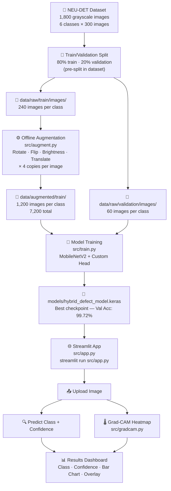
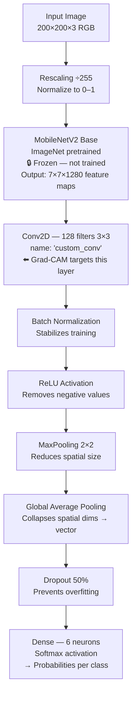
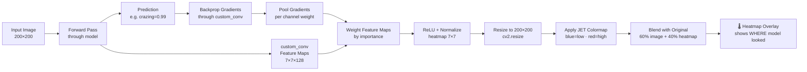

# 🔬 Industrial Surface Defect Classification

> An AI-powered system that automatically identifies steel surface defects and **visually explains** its decisions using Grad-CAM heatmaps.

---

## 🎯 What Does This Project Do?

You upload a photo of a steel surface → the system tells you **what defect it is** and **highlights exactly where** on the image the AI looked to make that decision.

```
 📷 Upload Image  →  🤖 AI Classifies  →  🌡️ Heatmap Shows Why
   (steel surface)     (e.g. "crazing")     (red = high attention)
```

**Validation Accuracy: 99.72%** across 6 defect types.

---

## 🏭 The 6 Defect Classes

| # | Class | Description | Appearance |
|---|---|---|---|
| 1 | **Crazing** | Network of fine cracks | Spider-web pattern across surface |
| 2 | **Inclusion** | Foreign material embedded in steel | Dark spots or patches of contamination |
| 3 | **Patches** | Surface blotches | Irregular light/dark patches |
| 4 | **Pitted Surface** | Small pits or holes | Rough, pock-marked texture |
| 5 | **Rolled-in Scale** | Oxide scale pressed into surface | Elongated dark marks along rolling direction |
| 6 | **Scratches** | Linear surface scratches | Fine parallel lines or gouges |

---

## ⚡ Quick Start

```bash
# 1. Install dependencies
pip install -r requirements.txt

# 2. Launch the web app (from project root)
streamlit run src/app.py
```

Then open **http://localhost:8501** in your browser and upload any surface image.

---

## 🗺️ Full System Flow



---

## 🧠 Model Architecture



---

## 🌡️ How Grad-CAM Works



---

## 📂 Project Structure

```
Industrial_Surface_Defect_Classification/
│
├── 📁 data/
│   ├── raw/                        ← Original NEU-DET dataset (never modified)
│   │   ├── train/images/{class}/   ← 240 images × 6 classes
│   │   └── validation/images/{class}/  ← 60 images × 6 classes
│   └── augmented/
│       └── train/{class}/          ← 1,200 images × 6 classes (orig + aug)
│
├── 📁 src/
│   ├── augment.py      ← Step 1: Generate augmented training images
│   ├── train.py        ← Step 2: Build + train the model
│   ├── gradcam.py      ← Step 3: Grad-CAM explainability module
│   └── app.py          ← Step 4: Streamlit web interface
│
├── 📁 models/
│   └── hybrid_defect_model.keras   ← Saved trained model
│
├── 📁 outputs/
│   ├── training_history.png        ← Accuracy/loss curves
│   └── gradcam_sample_*.bmp        ← Sample heatmap overlays
│
├── 📁 docs/                        ← Full documentation
│   ├── 01_PROJECT_OVERVIEW.md
│   ├── 02_DATA_PIPELINE.md
│   ├── 03_MODEL_ARCHITECTURE.md
│   ├── 04_GRADCAM_EXPLAINED.md
│   ├── 05_INFERENCE_FLOW.md
│   └── 06_METRICS_AND_RESULTS.md
│
├── requirements.txt
├── README.md
└── CONTRIBUTING.md
```

---

## 📈 Training Results

| Metric | Value |
|---|---|
| Training images | 7,200 (augmented) |
| Validation images | 360 (clean originals) |
| Best epoch | 6 of 30 |
| **Validation accuracy** | **99.72%** |
| Validation loss | 0.0098 |

---

## 🛠️ Tech Stack

| Component | Technology |
|---|---|
| Deep Learning | TensorFlow / Keras |
| Base Model | MobileNetV2 (ImageNet) |
| Explainability | Grad-CAM (tf.GradientTape) |
| Augmentation | OpenCV + NumPy |
| Web UI | Streamlit |
| Language | Python 3.10+ |

---

## 📖 Documentation

| Document | Contents |
|---|---|
| [Project Overview](docs/01_PROJECT_OVERVIEW.md) | Problem statement, goals, solution approach |
| [Data Pipeline](docs/02_DATA_PIPELINE.md) | Dataset details, augmentation strategy, data flow |
| [Model Architecture](docs/03_MODEL_ARCHITECTURE.md) | Layer-by-layer breakdown, design decisions |
| [Grad-CAM Explained](docs/04_GRADCAM_EXPLAINED.md) | How explainability works, step by step |
| [Inference Flow](docs/05_INFERENCE_FLOW.md) | Upload → predict → display, end-to-end |
| [Metrics & Verification](docs/06_METRICS_AND_RESULTS.md) | Training history, evaluation curves, reliability |
