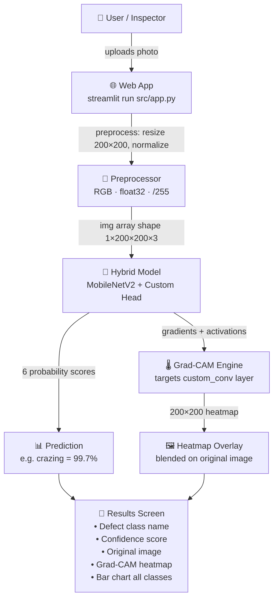
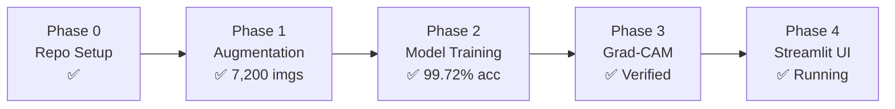

# 📋 Project Overview — Industrial Surface Defect Classification

## 🏭 The Problem

Steel manufacturing produces millions of meters of rolled steel every day. Surface defects — cracks, pits, scratches, inclusions — appear during rolling, cooling, and handling. Each defect:

- **Weakens** the structural integrity of the steel
- **Fails** quality control standards
- **Costs** money in rejected product and rework

Traditionally, trained human inspectors examine the steel under magnification. This is:
- **Slow** — one person can only inspect so much per hour
- **Inconsistent** — fatigue and subjectivity cause missed defects
- **Expensive** — requires skilled labor on every production line

---

## 💡 The Solution

An AI vision system that:

1. **Looks** at a photo of the steel surface
2. **Classifies** the type of defect instantly
3. **Explains** its decision visually (so engineers can trust and verify it)

```
Before (Human):         After (AI System):
  📷 Photo                📷 Photo
     ↓                       ↓
  👁️ Inspector           🤖 Model (< 1 second)
     ↓                       ↓
  📝 Judgement           📊 Class + 99.7% Confidence
  (minutes, variable)        ↓
                         🌡️ Heatmap (shows what the AI saw)
```

---

## 🎯 Project Goals

| Goal | Achieved |
|---|---|
| Classify all 6 NEU-DET defect types | ✅ |
| Accuracy above 95% on unseen data | ✅ 99.72% |
| Explain predictions visually | ✅ Grad-CAM |
| Run locally (no cloud needed) | ✅ Streamlit desktop app |
| Keep original data pristine | ✅ Augmented data stored separately |

---

## 🔄 Input → Output Flow (Plain English)



---

## 📦 What's In the Box

| File | What It Does |
|---|---|
| `src/augment.py` | Runs once — generates 7,200 training images from 1,440 originals |
| `src/train.py` | Runs once — trains the model, saves `hybrid_defect_model.keras` |
| `src/gradcam.py` | Library — called at inference time to generate heatmaps |
| `src/app.py` | The app — run this to use the system |
| `models/hybrid_defect_model.keras` | The trained brain — loaded by the app |

---

## 🗓️ Project Phases (How It Was Built)



