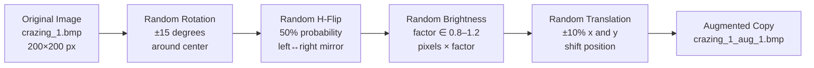
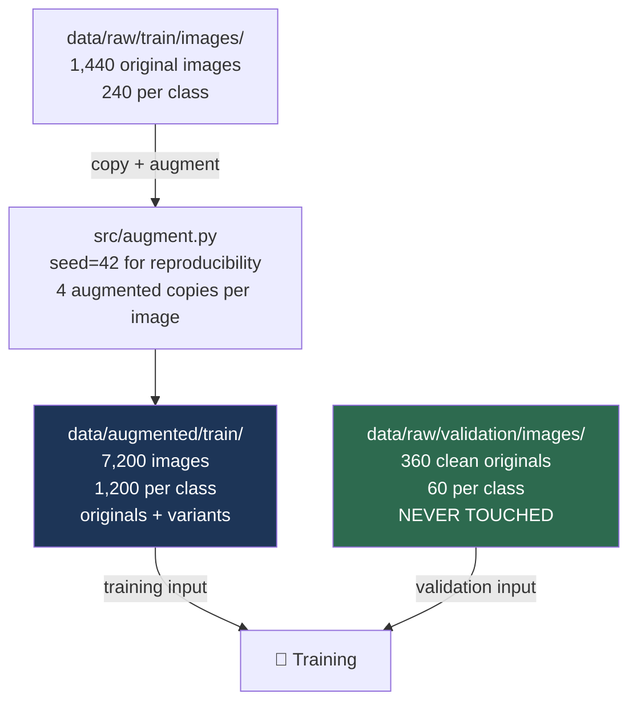

# 🔀 Data Pipeline — From Raw Dataset to Training-Ready Data

## 📊 The Dataset: NEU Surface Defect Database

| Property | Value |
|---|---|
| Source | Northeastern University (NEU), China |
| Total images | 1,800 |
| Image format | BMP, grayscale |
| Image size | 200 × 200 pixels |
| Classes | 6 |
| Images per class | 300 |
| Split used | 80% train (240) · 20% validation (60) |

### The 6 Classes at a Glance

```
┌─────────────────┬──────────────────────────────────────────────────────┐
│   Class Name    │  Visual Description                                  │
├─────────────────┼──────────────────────────────────────────────────────┤
│ crazing         │  Fine web of micro-cracks across the surface         │
│ inclusion       │  Dark foreign-material spots embedded in steel       │
│ patches         │  Irregular blotchy light/dark areas                  │
│ pitted_surface  │  Small pits or indentations, rough texture           │
│ rolled-in_scale │  Dark streaks of oxide scale pressed into surface    │
│ scratches       │  Long thin linear marks along or across the surface  │
└─────────────────┴──────────────────────────────────────────────────────┘
```

---

## 📁 Raw Data Layout (after rename from Data_Set_NEU-DET)

```
data/raw/
├── train/
│   └── images/
│       ├── crazing/           ← 240 images (crazing_1.bmp … crazing_240.bmp)
│       ├── inclusion/         ← 240 images
│       ├── patches/           ← 240 images
│       ├── pitted_surface/    ← 240 images
│       ├── rolled-in_scale/   ← 240 images
│       └── scratches/         ← 240 images
└── validation/
    └── images/
        ├── crazing/           ← 60 images
        ├── inclusion/         ← 60 images
        ├── patches/           ← 60 images
        ├── pitted_surface/    ← 60 images
        ├── rolled-in_scale/   ← 60 images
        └── scratches/         ← 60 images
```

> **Rule:** `data/raw/` is NEVER modified. It is the permanent ground truth.

---

## ⚙️ Why Augmentation?

The model needs variety to generalise. With only 240 training images per class:
- It could memorise the training set (overfitting)
- It would struggle with slightly rotated or brighter images at inference

Augmentation artificially expands the dataset by creating realistic variations.

---

## 🔧 Augmentation Transforms (applied by `src/augment.py`)



Each transform is applied **sequentially** to produce one variant. This runs 4 times per image to get 4 unique augmented copies.

---

## 📐 Augmented Data Layout (Option B — originals + copies together)

```
data/augmented/train/
├── crazing/
│   ├── crazing_1.bmp          ← original copy
│   ├── crazing_1_aug_1.bmp    ← rotated + flipped + brighter + shifted
│   ├── crazing_1_aug_2.bmp    ← different random values
│   ├── crazing_1_aug_3.bmp
│   ├── crazing_1_aug_4.bmp
│   ├── crazing_2.bmp          ← next original ...
│   └── ...
├── inclusion/ ...
└── ...
```

---

## 📊 Data Volume Summary

```
                 Per Class    Total (×6)
                ──────────   ──────────
 Raw train           240         1,440
 Augmented train   1,200         7,200   ← 5× multiplication
 Raw validation       60           360   ← NEVER augmented
```



---

## 🔄 How TensorFlow Loads the Data (in `train.py`)

```python
# Training — points to augmented folder
train_ds = image_dataset_from_directory(
    "data/augmented/train/",
    image_size=(200, 200),
    color_mode="rgb",     # grayscale → 3 channels (required by MobileNetV2)
    label_mode="int",     # class index as integer label
    shuffle=True,
    seed=42
)

# Validation — points to raw originals
val_ds = image_dataset_from_directory(
    "data/raw/validation/images/",
    image_size=(200, 200),
    color_mode="rgb",
    label_mode="int",
    shuffle=False         # keep order consistent for evaluation
)
```

> **Grayscale → RGB:** The images are grayscale (1 channel) but MobileNetV2 expects 3-channel RGB. Setting `color_mode="rgb"` makes TensorFlow duplicate the single channel into 3 identical channels automatically — no data is lost.

