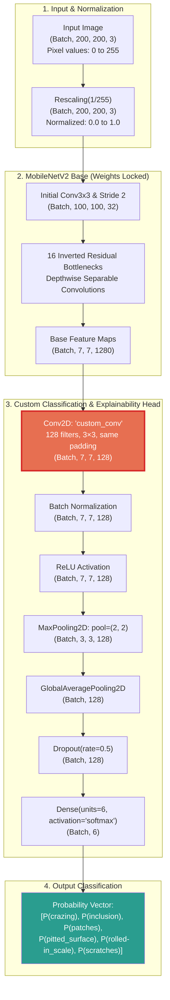

# 🧠 Model Architecture & Design

This document details the deep learning model architecture used for the **Industrial Surface Defect Classification** system, explaining the design rationale, layer-by-layer specifications, tensor dimensions, and training mechanics.

---

## 🏗️ Architectural Overview: The Transfer Learning Paradigm

Industrial inspection datasets are typically small compared to general vision datasets. With only 1,800 raw images (240 per class in train), training a deep convolutional network from scratch carries an extremely high risk of overfitting.

To solve this, we employ **Transfer Learning** using a hybrid architecture:
1. **Pre-trained Feature Extractor (Frozen Base)**: A `MobileNetV2` network pre-trained on the ImageNet dataset (1.4 million images, 1,000 categories). It already knows low-level edge, texture, boundary, and corner representations.
2. **Specialized Classification Head (Trainable Top)**: A custom convolutional block and classifier specifically designed to learn the high-level signatures of steel surface defects and serve as the target for visual explainability.

```
       INPUT
 [200 × 200 × 3 RGB]
         │
         ▼
┌─────────────────────────────────┐
│     MobileNetV2 Base (Frozen)   │  ◄── Pretrained on ImageNet
│  • Inverted Residual Blocks     │  ◄── Weights LOCKED (not updated)
│  • Depthwise Separable Convs    │
│  • Output shape: (7, 7, 1280)   │
└─────────────────────────────────┘
         │
         ▼
┌─────────────────────────────────┐
│   Custom Head (Trainable)       │
│  • Conv2D 'custom_conv' (128)   │  ◄── 🎯 Target layer for Grad-CAM
│  • BatchNormalization + ReLU    │
│  • MaxPooling2D (2, 2)          │
│  • GlobalAveragePooling2D       │
│  • Dropout (0.5)                │
│  • Dense (6, softmax)           │
└─────────────────────────────────┘
         │
         ▼
      OUTPUT
 [6 Class Probabilities]
```

---

## 🔬 Layer-by-Layer Specification & Tensor Progression

| # | Layer Name | Layer Type | Output Dimension | Description / Purpose |
|---|---|---|---|---|
| **0** | `input_layer` | InputLayer | `(None, 200, 200, 3)` | Accepts 200×200 3-channel RGB image normalized to $[0.0, 1.0]$. |
| **1** | `mobilenetv2_1.00_224` | Functional Base | `(None, 7, 7, 1280)` | 53 layers of inverted residual depthwise separable convolutions. Frozen. |
| **2** | `custom_conv` | Conv2D | `(None, 7, 7, 128)` | 128 filters ($3 \times 3$, padding='same'). Extracts defect-specific spatial patterns. **Grad-CAM target**. |
| **3** | `batch_normalization` | BatchNormalization | `(None, 7, 7, 128)` | Stabilizes activations, speeds convergence, prevents internal covariate shift. |
| **4** | `activation` | Activation (ReLU) | `(None, 7, 7, 128)` | Non-linear activation: $\max(0, x)$. |
| **5** | `max_pooling2d` | MaxPooling2D | `(None, 3, 3, 128)` | Window size $2 \times 2$. Downsamples spatial dimensions from $7 \times 7 \to 3 \times 3$. |
| **6** | `global_average_pooling2d` | GlobalAvgPooling2D | `(None, 128)` | Spatial average across each of the 128 feature maps ($3 \times 3 \to 1$). |
| **7** | `dropout` | Dropout ($p=0.5$) | `(None, 128)` | 50% neuron dropout during training to prevent co-adaptation. |
| **8** | `dense` | Dense | `(None, 6)` | 6 fully connected output units with `softmax` activation. |

---

## 📐 Detailed Flowchart with Tensor Transformations



---

## 📊 Parameter Distribution

```
================================================================================
Total Model Parameters:        3,745,286  (~14.3 MB)
Trainable Parameters:          1,486,854  (~5.7 MB)   [Custom Head + Top Blocks]
Non-trainable Parameters:      2,258,432  (~8.6 MB)   [Frozen MobileNetV2 Base]
================================================================================
```

### Why This Balance Matters
- **Frozen Base ($2.25\text{M}$ weights)**: Keeps general visual knowledge intact without needing millions of domain-specific images.
- **Trainable Head ($1.49\text{M}$ weights)**: Provides enough expressive capacity to differentiate between nuanced surface steel defects (e.g., distinguishing crazing hairline networks from rolled-in scale indentations).

---

## ⚙️ Loss Function & Optimization Strategy

### 1. Loss: Sparse Categorical Crossentropy
Since class indices are mutually exclusive integers ($y \in \{0, 1, 2, 3, 4, 5\}$):

$$\mathcal{L} = -\log\left(\frac{e^{z_y}}{\sum_{j=1}^{6} e^{z_j}}\right)$$

Where $z_y$ is the model's raw logit for ground truth category $y$.

### 2. Optimizer: Adam with Fixed Learning Rate
- Initial learning rate: $\alpha = 1 \times 10^{-3}$
- $\beta_1 = 0.9$, $\beta_2 = 0.999$, $\epsilon = 10^{-7}$
- Dynamically adapts per-parameter learning rates based on first and second moments of gradients.

### 3. Training Safeguards
- **`ModelCheckpoint`**: Monitors `val_accuracy` and saves only the model checkpoint that achieves the highest validation score (`save_best_only=True`).
- **`EarlyStopping`**: Monitors `val_accuracy` with `patience=5`. When 5 consecutive epochs show no improvement, training halts and weights from the peak epoch are automatically restored (`restore_best_weights=True`).

