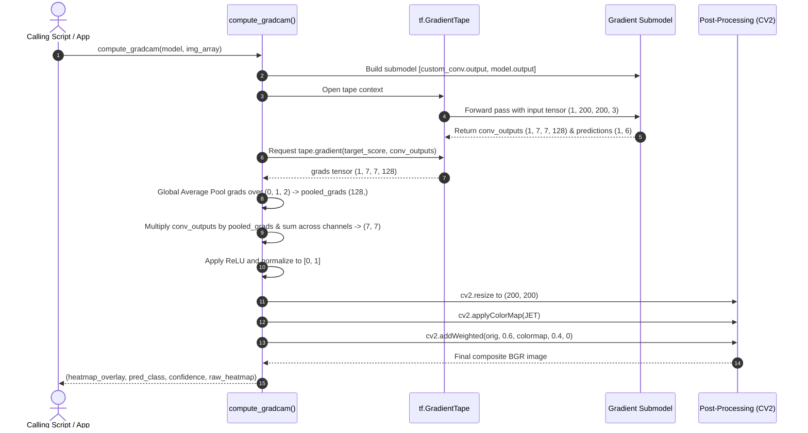

# 🌡️ Grad-CAM Explained — Visual Explainability for Industrial AI

## ❓ The "Black Box" Problem in Industrial AI

In factory production lines, a model simply outputting `"crazing: 99.7%"` is not enough. If an operator or quality control engineer cannot see **why** the AI made that decision:
- A false positive could shut down an entire rolling mill unnecessarily.
- The model might be "cheating" by focusing on an image artifact, lighting glare, or border noise rather than the real surface defect.
- Regulators and plant managers cannot audit the machine's reasoning.

**Grad-CAM (Gradient-weighted Class Activation Mapping)** solves this by making the deep neural network transparent: it generates a heat map highlighting the exact pixels and regions that influenced the model's prediction.

---

## 🔬 How Grad-CAM Works: Conceptual Overview

```
Input Image ──► [ Model Forward Pass ] ──► Class Score y^c (e.g. Crazing)
                       ▲                                │
                       │                                ▼
                Activation Maps               Backpropagate Gradients
                 A^k of layer                 ∂y^c / ∂A^k
                 'custom_conv'                          │
                       │                                ▼
                       │                        Average Pooled
                       │                        Weights α_k^c
                       ▼                                │
                   Linear Combination ◄─────────────────┘
                   ∑ (α_k^c × A^k)
                       │
                       ▼
                    Apply ReLU
                       │
                       ▼
            Upsample & Colormap JET
                       │
                       ▼
            Superimposed Heatmap
```

---

## 🧮 Mathematical Walkthrough (Step-by-Step)

### Step 1: Extract Feature Maps from Target Layer
We target `custom_conv` ($128$ filters, spatial resolution $7 \times 7$). Let $A^k \in \mathbb{R}^{7 \times 7}$ represent the activation map produced by channel $k$ ($k \in [1, 128]$).

### Step 2: Compute Gradients via Backpropagation
We compute the gradient of the predicted class score $y^c$ (before or after softmax) with respect to each feature map $A^k$:

$$\frac{\partial y^c}{\partial A^k_{i,j}}$$

where $(i, j)$ are the spatial coordinates within the $7 \times 7$ feature map.

### Step 3: Compute Neuron Importance Weights ($\alpha_k^c$)
We apply **Global Average Pooling** across the spatial dimensions $(u, v)$ to calculate the importance weight $\alpha_k^c$ of feature map $k$ for class $c$:

$$\alpha_k^c = \frac{1}{Z} \sum_{i=1}^{7} \sum_{j=1}^{7} \frac{\partial y^c}{\partial A_{i,j}^k}$$

where $Z = 7 \times 7 = 49$ (the number of spatial pixels in the feature map).

- If $\alpha_k^c > 0$: Feature map $k$ **increases** the confidence for defect $c$.
- If $\alpha_k^c < 0$: Feature map $k$ **suppresses** confidence for defect $c$.

### Step 4: Weighted Combination and Rectified Linear Unit (ReLU)
We calculate a weighted sum of all $128$ feature maps using the weights $\alpha_k^c$, and pass the result through a **ReLU** function:

$$L_{\text{Grad-CAM}}^c = \text{ReLU}\left( \sum_{k=1}^{128} \alpha_k^c A^k \right)$$

> **Why ReLU?** We only care about features that positively support the predicted defect class. Features that decrease the probability belong to other classes and would dilute the localization map.

### Step 5: Normalization
The resulting $7 \times 7$ activation grid is normalized to the range $[0.0, 1.0]$:

$$H_{i,j} = \frac{L_{i,j} - \min(L)}{\max(L) - \min(L) + \epsilon}$$

### Step 6: Upsampling, Colormap, & Alpha Blending
1. **Upsampling**: Bilinear interpolation (`cv2.resize`) stretches the $7 \times 7$ heatmap to the original image dimensions ($200 \times 200$).
2. **Colormapping**: The normalized single-channel values $[0, 255]$ are passed through OpenCV's `COLORMAP_JET`:
   - 🔵 **Blue**: Low/Zero activation (irrelevant background or unaffected steel surface)
   - 🟡 **Yellow / Green**: Moderate activation (defect boundaries)
   - 🔴 **Red**: High activation (core defect structures)
3. **Alpha Blending**: The heatmap is combined with the original image $I_{\text{orig}}$:

$$I_{\text{overlay}} = 0.6 \cdot I_{\text{orig}} + 0.4 \cdot I_{\text{colormap}}$$

---

## 🔄 Sequence Diagram: Code Execution in `src/gradcam.py`



---

## 🎨 Interpreting Grad-CAM Outputs

```
┌─────────────────────────────────┬─────────────────────────────────┐
│     Original Grayscale Image    │        Grad-CAM Heatmap         │
├─────────────────────────────────┼─────────────────────────────────┤
│                                 │   ░░░░░░░░░░░░░░░░░░░░░░░░░░    │
│   ───-─--──---───-───────       │   ░░░░░░░█████████░░░░░░░░░░    │
│   ───────═══─────────────       │   ░░░░░█████████████░░░░░░░░    │
│   ───────────-───────────       │   ░░░░░░░█████████░░░░░░░░░░    │
│                                 │   ░░░░░░░░░░░░░░░░░░░░░░░░░░    │
│  (Subtle micro-crack pattern)   │   (Bright red spot on fracture) │
└─────────────────────────────────┴─────────────────────────────────┘
```

| Visual Cue | Interpretation | Engineering Action |
|---|---|---|
| **Concentrated Red Area on Defect** | The model correctly identified the defect pattern. | High trust. Pass inspection flag. |
| **Diffuse / Spread Out Colors** | Low confidence; model found ambiguous or faint features. | Flag for human secondary review. |
| **Hotspot on Border or Glare** | False alert due to optical reflection or camera vignetting. | Adjust lighting / camera calibration. |
