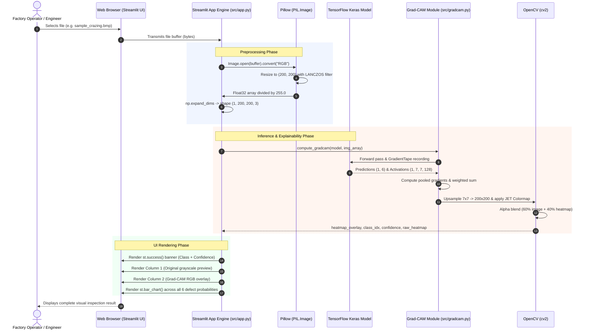

# 🔄 Inference Flow — End-to-End Execution Trace

This document provides a comprehensive breakdown of the inference pipeline, tracking how an uploaded image travels through the system from the browser UI to the deep learning model and back to the user screen.

---

## 🗺️ High-Level System Architecture

```mermaid
flowchart TD
    subgraph CLIENT["User Browser (Client)"]
        UI["Streamlit Web Page\nhttp://localhost:8501"]
        UPLOAD["File Uploader Widget\n(.bmp, .jpg, .png)"]
    end

    subgraph SERVER["Local Machine (Python Runtime)"]
        APP["src/app.py\nStreamlit Server Engine"]
        CACHE["@st.cache_resource\nIn-Memory Model Storage"]
        PRE["PIL Preprocessor\nResize 200×200 · RGB · Scale [0,1]"]
        MODEL["TensorFlow / Keras Runtime\nhybrid_defect_model.keras"]
        GCAM["src/gradcam.py\nGradientTape Engine"]
    end

    subgraph OUTPUT_DASH["Interactive Dashboard Output"]
        KPI["Confidence Banner\nPredicted: CLASS (99.7%)"]
        COLS["Side-by-Side Images\nOriginal Image | Grad-CAM Heatmap"]
        CHART["Probability Distribution\nHorizontal / Vertical Bar Chart"]
    end

    UI --> UPLOAD
    UPLOAD -->|Raw Bytes| APP
    APP --> PRE
    PRE -->|Tensor: (1, 200, 200, 3)| MODEL
    CACHE -.->|Cached Weights| MODEL
    MODEL -->|Logits & Activations| GCAM
    GCAM -->|Overlay Image Array| APP
    MODEL -->|Class Probabilities| APP
    APP --> KPI
    APP --> COLS
    APP --> CHART
    KPI --> UI
    COLS --> UI
    CHART --> UI
```

---

## ⏱️ Step-by-Step Lifecycle of a Prediction



---

## 📊 Data Representation & Tensor Transformations

| Stage | Module | Data Representation | Shape | Range / Type |
|---|---|---|---|---|
| **Raw Upload** | Browser | Raw image file buffer | N/A (binary) | `bytes` |
| **Loaded Image** | `PIL.Image` | Decoded RGB Image | $(H_{\text{raw}}, W_{\text{raw}}, 3)$ | `uint8` $[0, 255]$ |
| **Resized** | `PIL.Image` | Standardized resolution | $(200, 200, 3)$ | `uint8` $[0, 255]$ |
| **Normalized** | `numpy` | Float array divided by $255.0$ | $(200, 200, 3)$ | `float32` $[0.0, 1.0]$ |
| **Batch Ready** | `numpy` | Added batch axis (`axis=0`) | $(1, 200, 200, 3)$ | `float32` $[0.0, 1.0]$ |
| **Conv Features** | `custom_conv` | Feature maps extracted | $(1, 7, 7, 128)$ | `float32` |
| **Predictions** | `Dense(6)` | Softmax probability vector | $(1, 6)$ | `float32` $\sum = 1.0$ |
| **Heatmap Grid** | `gradcam` | Normalized activation score | $(7, 7)$ | `float32` $[0.0, 1.0]$ |
| **Interpolated** | `cv2.resize` | Upscaled spatial map | $(200, 200)$ | `float32` $[0.0, 1.0]$ |
| **Colored Heatmap** | `cv2.COLORMAP_JET`| 3-channel false-color map | $(200, 200, 3)$ | `uint8` (BGR) |
| **Overlay Output** | `cv2.addWeighted`| Final composite blend | $(200, 200, 3)$ | `uint8` (BGR $\to$ RGB) |

---

## ⚡ Performance & Resource Profile

| Metric | Typical Value on Local PC (CPU) |
|---|---|
| **Model Size on Disk** | $\sim 14.3 \text{ MB}$ |
| **RAM Footprint (Loaded Model)** | $\sim 120 \text{ MB}$ |
| **Cold Start Time** (Model Loading) | $\sim 1.5 - 2.5 \text{ seconds}$ (happens once via cache) |
| **Preprocessing Latency** | $< 15 \text{ ms}$ |
| **Inference + Grad-CAM Latency** | $\sim 70 - 150 \text{ ms}$ per image on standard CPU |
| **Browser Render Time** | $< 50 \text{ ms}$ |
| **Total Turnaround Time** | **$\sim 0.15 - 0.25 \text{ seconds}$ per image** |

---

## 🛡️ Edge Cases & Error Handling

1. **Unsupported File Format**:
   - Streamlit widget rejects files outside `['jpg', 'jpeg', 'png', 'bmp']`.
2. **Missing Model File**:
   - `src/app.py` checks `MODEL_PATH.exists()`. If missing, an error banner instructs the user to run `python src/train.py` rather than throwing an unhandled exception.
3. **Channel Mismatch**:
   - Grayscale BMP files or RGBA PNGs are automatically normalized to RGB 3-channel via `.convert("RGB")`.
4. **Non-square or High-res Images**:
   - Any uploaded resolution is smoothly downsampled to $200 \times 200$ using the Lanczos anti-aliasing resampling filter.
